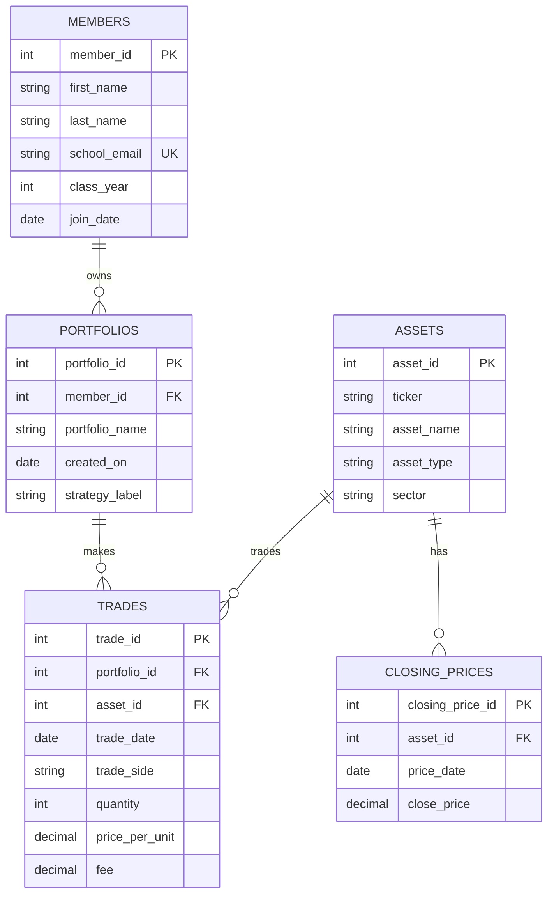

# 1. **The Scenario.**

Option B: Babson Investment Club.

The Babson Investment Club runs paper portfolios for its members to learn with. Each member can own one or more portfolios, and each portfolio records trades in assets that the club follows. The club keeps a full history of trades, tracks closing prices by day, and wants to answer questions about holdings, portfolio performance, and rule violations.

# 2. **The ERD.**

# 3. **What One Row Means.**

One row of `members` is one club member with one school email, class year, and join date.

One row of `portfolios` is one paper portfolio owned by one member.

One row of `assets` is one asset the club follows, identified by its ticker and its type and sector.

One row of `trades` is one buy or sell made by one portfolio in one asset on one date.

One row of `closing_prices` is one asset's closing price on one trading day.

# 4. **Design Choices.**
db: add the question and the plan