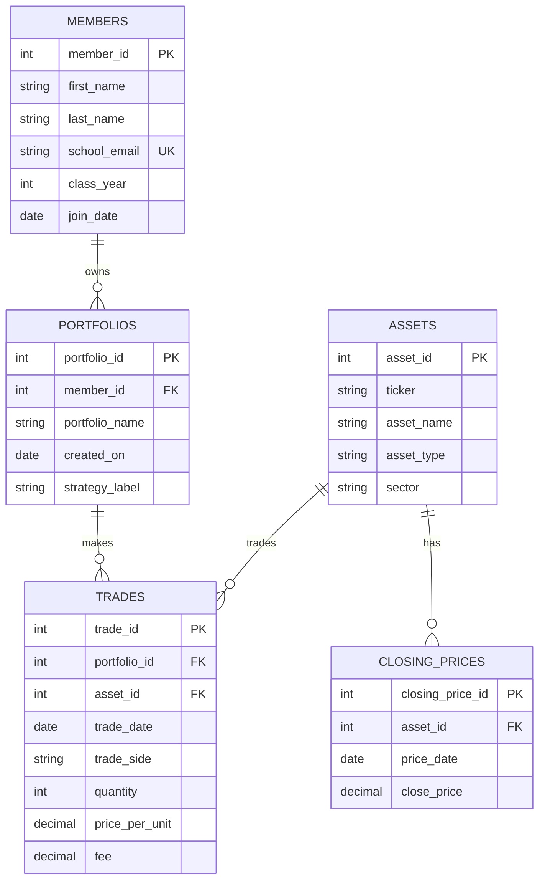

# 1. **The Scenario.**

Option B: Babson Investment Club.

The Babson Investment Club runs paper portfolios for its members to learn with. Each member can own one or more portfolios, and each portfolio records trades in assets that the club follows. The club keeps a full history of trades, tracks closing prices by day, and wants to answer questions about holdings, portfolio performance, and rule violations.

# 2. **The ERD.**

# 3. **What One Row Means.**

One row of `members` is one club member with one school email, class year, and join date.

One row of `portfolios` is one paper portfolio owned by one member.

One row of `assets` is one asset the club follows, identified by its ticker and its type and sector.

One row of `trades` is one buy or sell made by one portfolio in one asset on one date.

One row of `closing_prices` is one asset's closing price on one trading day.

# 4. **Design Choices.**
I used asset_id as the main key for the assets table because the club’s real data includes a ticker change over time, so the asset itself needs one stable identity for its key. The optional relationship are mostly at the top of the chain: a member can have no portfolios, a portfolio can have no trades yet, and a strategy label can be blank, while each individual trade still belongs to exactly one member’s portfolio and exactly one asset. The rule that a portfolio cannot sell more units than it currently owns is not something the table can enforce by itself because it depends on the running total across earlier trades. My agent suggested a simpler table with only current holdings, but I did not use it because the club wants a full trade history and a clean audit trail, so I kept separate trades and closing_prices tables instead.