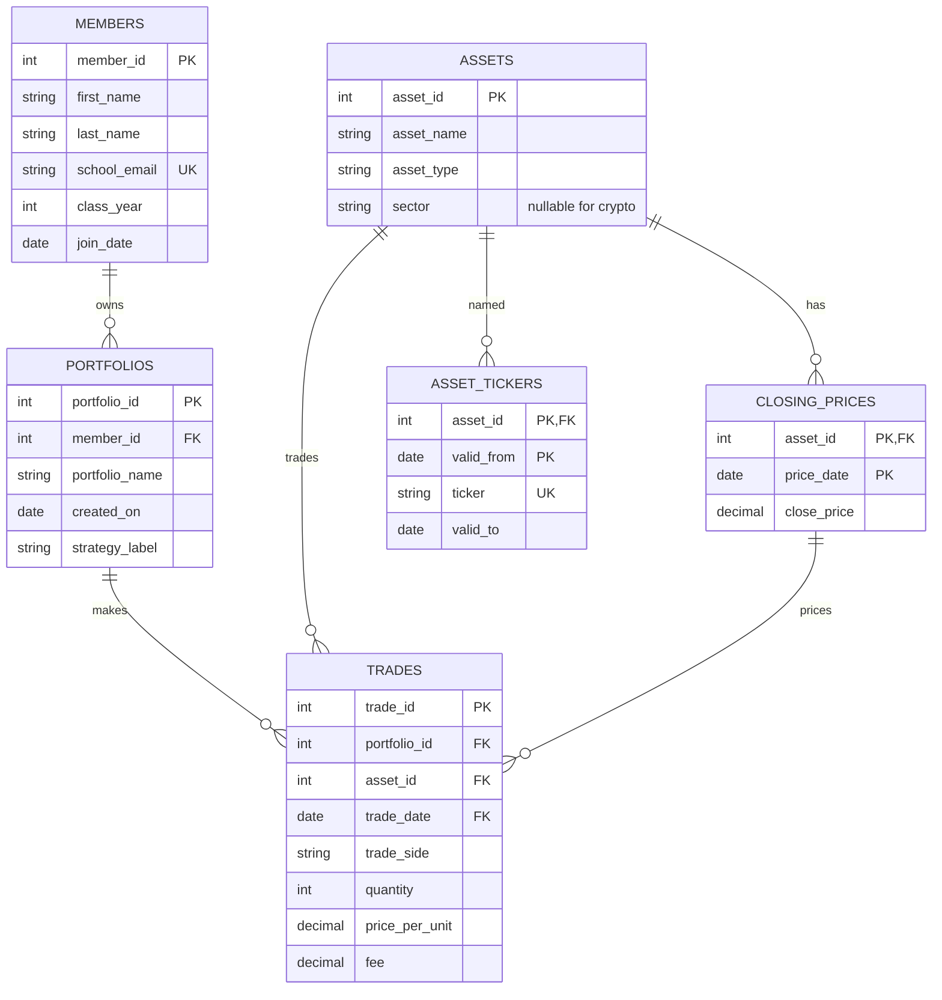

# 1. **The Scenario.**

Option B: Babson Investment Club.

The Babson Investment Club runs paper portfolios for its members to learn with. Each member can own one or more portfolios, and each portfolio records trades in assets that the club follows. The club keeps a full history of trades, tracks closing prices by day, and wants to answer questions about holdings, portfolio performance, and rule violations.

# 2. **The ERD.**

# 3. **What One Row Means.**

One row of `members` is one club member with one school email, class year, and join date.

One row of `portfolios` is one paper portfolio owned by one member.

One row of `assets` is one asset the club follows, identified by its stable `asset_id`, name, type, and sector. Crypto has no sector.

One row of `asset_tickers` is one ticker symbol used by an asset during a date range. The Facebook asset has `FB` through June 8, 2022 and `META` starting June 9, 2022.

One row of `trades` is one buy or sell made by one portfolio in one asset on one date.

One row of `closing_prices` is one asset's closing price on one date. The `asset_id` and `price_date` together are its primary key.

# 4. **Design Choices.**
I used `asset_id` as the stable key because a ticker can change while the asset stays the same. The `asset_tickers` table records each ticker's effective dates. A member can have no portfolios, a portfolio can have no trades yet, and a strategy label can be blank. A trade has one portfolio, one asset, and one matching closing price; the database also prevents a portfolio from trading the same asset twice on one day. The rule that a portfolio cannot sell more units than it currently owns depends on earlier trades, so it is checked with a query rather than a table constraint. The club keeps trades and closing prices separately for a full history.